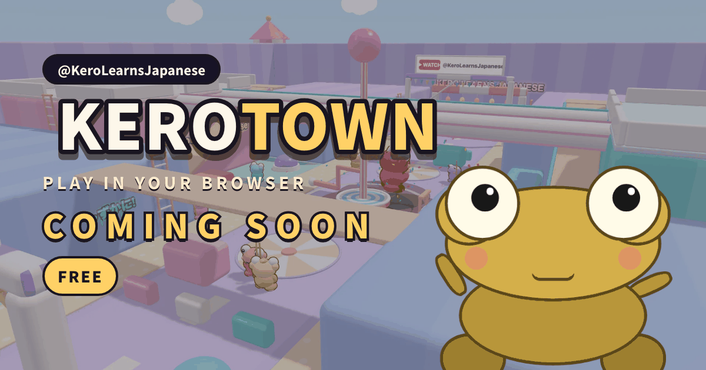
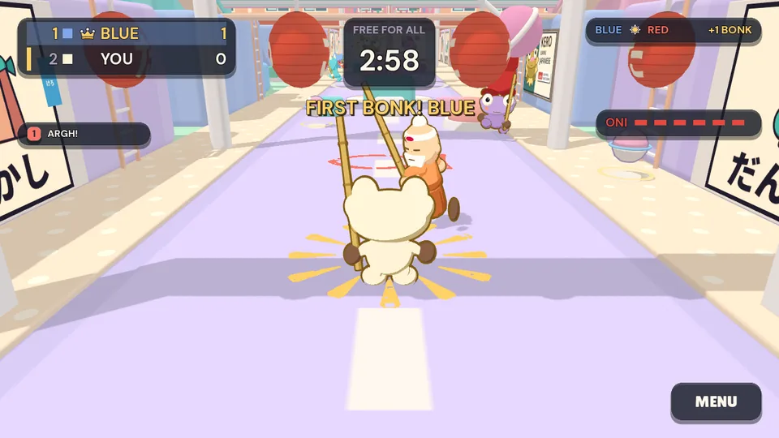
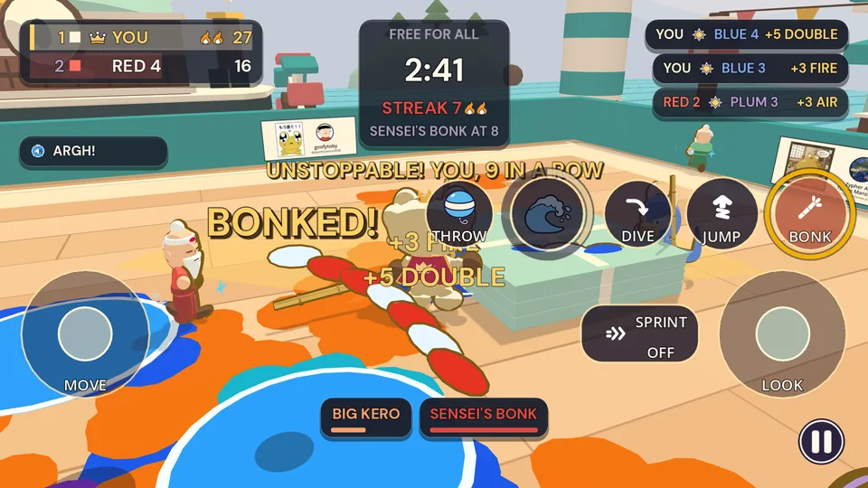
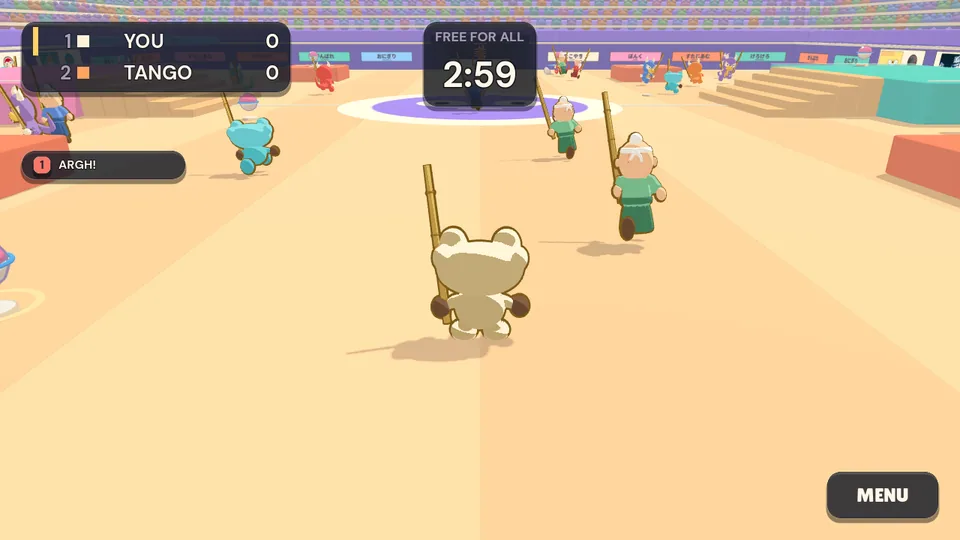
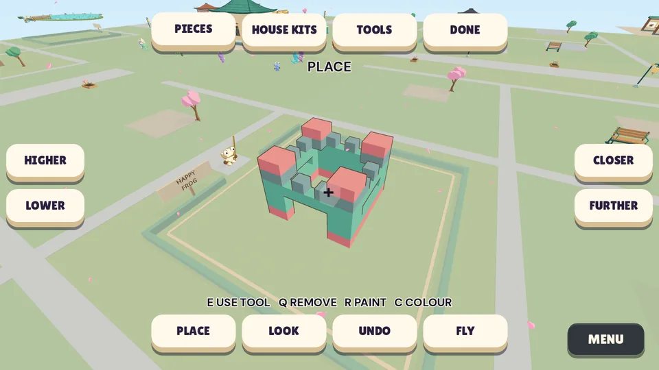

  

<h1 align="center">Kero Learns Japanese</h1>

  Kero is a frog who is learning Japanese. He gets a phrase wrong, somebody puts him right, 
  and you come away knowing one thing. It is a YouTube channel and a game.

  <a href="https://kerolearnsjapanese.com/kerotown/"><b>KEROTOWN</b></a>
  &nbsp;&nbsp;.&nbsp;&nbsp;
  <a href="https://www.youtube.com/@KeroLearnsJapanese/shorts"><b>Watch on YouTube</b></a>
  &nbsp;&nbsp;.&nbsp;&nbsp;
  <a href="https://github.com/Kero-Learns-Japanese/issue-tracker"><b>Report a bug or share an idea</b></a>

---

## KEROTOWN

A free online game starring Kero, coming to Google Play and the App Store in December 2026.

- **Bonk.** Pick Kero, Sensei or Goro, grab a bamboo stick and bonk everyone flat.
- **Play online** with friends in a party, with chat and voice.
- **Four maps and race courses:** Bonk Street, Mochi Harbor, Kero Stadium and The Castle.
- **Three ways to fight:** free for all, team bonk and domination.
- **Kero Town:** buy a plot and build your own house, block by block.
- **Make things:** your own sounds in MY MIX, and drawings.
- **Your own page** on the website, with your fighter, what you wear and your scores.

<table>
  <tr>
    <td width="50%" align="center">
       
      <b>BONK STREET</b>
    </td>
    <td width="50%" align="center">
       
      <b>MOCHI HARBOR</b>
    </td>
  </tr>
  <tr>
    <td width="50%" align="center">
       
      <b>KERO STADIUM</b>
    </td>
    <td width="50%" align="center">
       
      <b>BUILD IN KERO TOWN</b>
    </td>
  </tr>
</table>

## Help make it better

Found a bug, or have an idea? [Tell us in the issue tracker](https://github.com/Kero-Learns-Japanese/issue-tracker).
Everything posted there is public, so never post a real name or anything personal.

## The code

Private while the game is being built. This page and the issue tracker are the public part.
